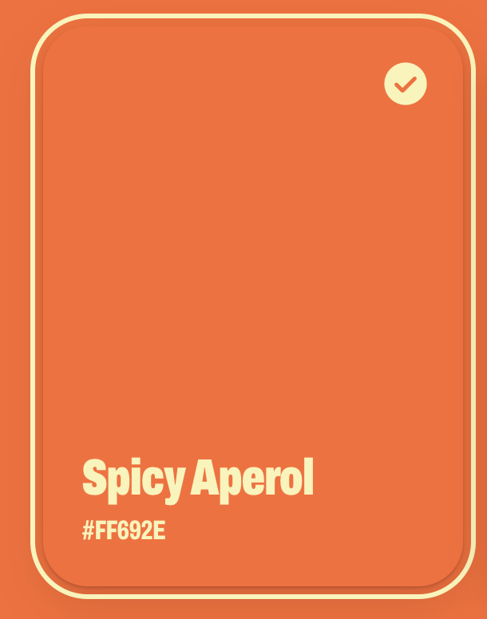

# Life's look

What we've settled on while designing Life live. It's the reference for every new piece of UI.

## The reference card

You picked this card as the one to build from: **"everything about this card is great: the border, the tick, the font, the color of the font."** New UI should feel like it.

| Part | Exactly |
| --- | --- |
| Shape | Corner radius 28 px (`--md-sys-shape-corner-extra-large`); proportions 3 : 4; padding 24 px |
| Fill | Spicy Aperol `#FF692E` (`--aperol`) |
| Text color | Cream `#FAF3B5` (`--aperol-cream`) |
| Title | Archivo, weight 900, 32 px on 36 px, width 68 %, tracking −0.02 em (`t-headline-large`) |
| Subtitle | Archivo, weight 800, 17 px on 22 px, width 68 %, tracking −0.02 em (`t-title-medium`) |
| Layout | Text at the bottom left: a column, `justify-content: flex-end`, gap 4 px |
| Shadow | `0 1px 2px rgb(80 20 0 / 0.25), 0 10px 28px rgb(80 20 0 / 0.18)`: warm, never grey |
| Selected: border | A 3 px cream outline, 5 px **outside** the card (`outline-offset: 5px`), following its corners |
| Selected: tick | Material Symbols Rounded `check_circle`, filled, 32 px, cream, 20 px from the top and right |
| Selected: lift | Raised 8 px (`translateY(-8px)`) |
| Hover | Raised 4 px |
| Press | Corners tighten to 16 px and it shrinks to 97 %, on a spring (`--md-sys-motion-spring-fast-spatial`, 350 ms) |
| Motion | Lift and settle on `--md-sys-motion-spring-default-spatial` (500 ms) |

On the lighter shades, the same card swaps cream for ink (`#5D240E`): text, outline and tick.

The code lives in `src/web/styles.css` (`.palette .chip`) and `src/web/app.tsx` (`PalettePreview`) for now. It becomes a kit component when we use it for real.

## The palette

| Name | Hex | Token | Text on it |
| --- | --- | --- | --- |
| Spicy Aperol | `#FF692E` | `--aperol` | cream |
| Light | `#FF925E` | `--aperol-light` | ink |
| Lighter | `#FFB990` | `--aperol-lighter` | ink |
| Lightest | `#FFDDC6` | `--aperol-lightest` | ink |
| Cream | `#FAF3B5` | `--aperol-cream` | |
| Ink | `#5D240E` | `--aperol-ink` | |

The lighter shades are even steps in OKLCH from Spicy Aperol: the same hue, gently less saturated and a little warmer (toward apricot) as they lighten, so they never go pink or grey. Ink is the same hue, very dark.

## Type

**Archivo** (Google Fonts, variable: width 62–125 %, weight 100–900).
- Display, headline and title styles: heavy (900, titles 800), condensed to 68 %, set tight (−0.02 em). This is the "Spicy Aperol" lettering.
- Body and label styles: Archivo at normal width and weight, for reading.

## Background

Flat Spicy Aperol by default, with no gradient and no grain. Any palette shade can be the background; text on it follows the shade (cream on Spicy Aperol, ink on the lighter ones).

## What didn't work

- Saturated, many-color gradients (orange, pink, yellow and lilac together): "sooo ugly". When gradients come back, keep them light and airy, like an out-of-focus photo.
- Window chrome: no title bar, buttons, headline or menu in the Mac app.
